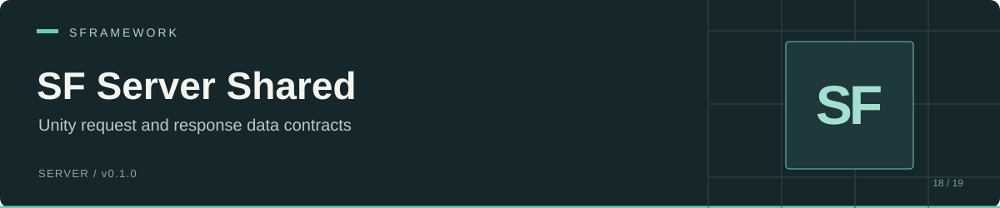

# SF Server Shared

Shared C# request and response contracts for SF Server integrations. This Unity Package Manager library contains data transfer objects for login, connection checks, sessions, analytics, device metadata, and Android purchase validation.

The package provides types and endpoint metadata. Your application supplies HTTP transport, authentication headers, URL construction, compression, and retries.

[Installation](#installation) · [Contracts](#contracts) · [Example](#example) · [Integration notes](#integration-notes) · [Repository map](#repository-map)

## Package identity

| Setting | Value |
| --- | --- |
| UPM package ID | `sp.sfserver.shared` |
| Display name | SF Server Shared |
| Package version | `0.1.0` |
| Assembly | `SFServer.Shared` |
| Namespace | `SFServer.Shared.Client.*` |
| Declared Unity baseline | `2019.4` in `package.json`; compatibility has not been tested here |
| Serialization annotations | MemoryPack |

## Installation

In Unity, open **Window → Package Manager → Add package from Git URL** and enter:

```text
https://github.com/huran438/sf-server-client.git#master
```

Alternatively, add the package to the `dependencies` object in your project's `Packages/manifest.json`:

```json
"sp.sfserver.shared": "https://github.com/huran438/sf-server-client.git#master"
```

That line belongs inside the existing object; it is not a complete manifest. Use a reviewed commit SHA in place of `master` when you need a reproducible package revision.

Install the MemoryPack runtime and its C# source generator in the consuming project. DTOs use `[MemoryPackable]`, partial classes, and union attributes. The package's `dependencies` object is empty, so UPM does not install MemoryPack automatically. The assembly definition lists `MemoryPack.Core.dll` under `precompiledReferences`; it does not bundle that DLL or declare a tested MemoryPack version.

Verify compilation in your actual Unity editor and target platform. The manifest's `2019.4` declaration alone does not establish compatibility with the C# syntax and source generation used by these contracts.

## Contracts

| Area | Main types | Endpoint value stored by the request |
| --- | --- | --- |
| Connection | `CheckConnectionRequest`, `CheckConnectionResponse` | `Connection/check` |
| Login | `LoginRequest`, `LoginResponse` | `Auth/login` |
| Google Play login | `GooglePlayLoginRequest` | `Auth/GooglePlayLogin` |
| Session lifecycle | `StartSessionRequest`, `ResumeSessionRequest`, `EndSessionRequest`, `UserSession` | `Session/start`, `Session/resume`, `Session/end` |
| Analytics | `AnalyticsEventDto`, `AnalyticsEventRequest`, `AnalyticsEventResponse` | `Analytics/batch` |
| Android purchase validation | `AndroidPurchaseValidationRequest`, `AndroidPurchaseValidationResponse` | `Purchases/validate-android` |
| Application and device metadata | `ApplicationInfo`, `DeviceInfo` | No endpoint |

`SFRequest` implements `ISFRequest`. Its `Endpoint` property is marked `[MemoryPackIgnore]`, so routing metadata is excluded from the serialized payload. Responses implement `ISFResponse`; `SFResponse` provides an empty success response type.

`LoginRequestBase` shares credential, device, and application fields. Its MemoryPack union tags are `0` for `LoginRequest` and `1` for `GooglePlayLoginRequest`. Preserve these tags and match serialization types on both ends of a connection.

## Example

This example constructs and round-trips a DTO locally after MemoryPack is configured. It does not send a network request.

```csharp
using MemoryPack;
using SFServer.Shared.Client.Connection;

public static class ConnectionContractExample
{
    public static CheckConnectionRequest RoundTrip()
    {
        var request = new CheckConnectionRequest
        {
            Credential = "",
            DeviceId = "local-development-device"
        };

        byte[] payload = MemoryPackSerializer.Serialize(request);
        return MemoryPackSerializer.Deserialize<CheckConnectionRequest>(payload);
    }
}
```

A login request can also carry an `ApplicationInfo` with `AppIdentifier`, `AppVersion`, `UnityVersion`, and `Platform`, plus a `DeviceInfo` describing the device and display. `LoginResponse` exposes `UserId`, profile fields, `ExpirationDate`, and `JwtToken`.

## Integration notes

- Treat endpoint strings as contract metadata. Confirm the full server URL, project prefix, HTTP method, body shape, and media type against the server version you deploy.
- Use matching DTO definitions and MemoryPack versions across producer and consumer. Added fields, reordered fields, union changes, or differing serialization types can break a binary contract.
- This repository does not define a base URL, environment variables, an HTTP client, token storage, or Brotli compression. Configure those in the application that consumes the package.
- `AnalyticsEventRequest` wraps an `Events` list; do not assume every server accepts that wrapper rather than a raw event list.
- `CheckConnectionRequest` contains `Credential` and `DeviceId`; its response contains `ServerTime` and `DebugMode`. Verify the full integration contract against the server you use.
- Purchase DTOs describe a validation exchange. They do not perform store billing, acknowledge purchases, or establish that a payment succeeded.

## Repository map

| Path | Contents |
| --- | --- |
| [package.json](./package.json) | UPM metadata |
| [SFServer.Shared.asmdef](./SFServer.Shared.asmdef) | Unity assembly definition |
| [Base](./Base/) | Request and response interfaces and base types |
| [Auth](./Auth/) | Login contracts and MemoryPack union |
| [Connection](./Connection/) | Connection check contracts |
| [Common](./Common/) | Application and device metadata |
| [Session](./Session/) | Session requests and session model |
| [Analytics](./Analytics/) | Event and batch contracts |
| [Purchases](./Purchases/) | Android purchase validation contracts |

## Troubleshooting

| Symptom | Check |
| --- | --- |
| `MemoryPack` namespace or generated serializer is missing | Install the runtime and source generator in the consuming project; inspect Unity compiler diagnostics. |
| Package imports but C# compilation fails | Check your Unity/C# toolchain and the actual MemoryPack installation; the manifest baseline is not a tested matrix. |
| Deserialization fails | Compare DTO revision, concrete/union serialization type, and transport compression with the server. |
| An endpoint returns 404 or rejects a body | Verify the complete route and body in the server; `Endpoint` does not build or validate URLs. |

## License

No license file was found in this repository snapshot.

## Verification scope

This README was checked against the `master` source snapshot at commit `0e3846cb4c234b49ac799dc8f09b5148cf861d9d`. Package metadata, DTO fields, union tags, and endpoint values were inspected. Unity import, generated serialization, HTTP integration, store purchases, and platform builds were not run.
